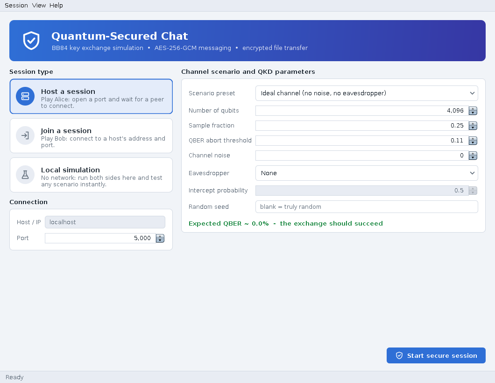
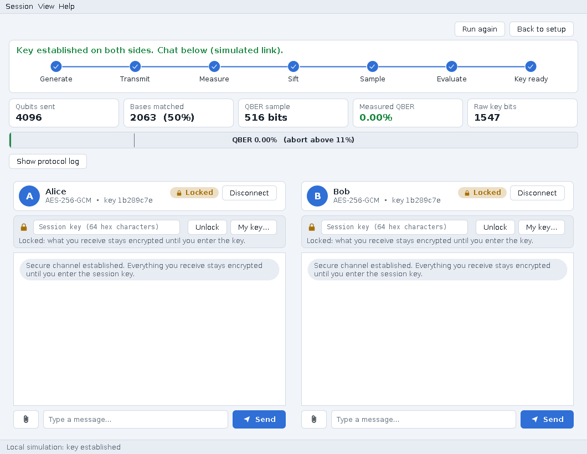
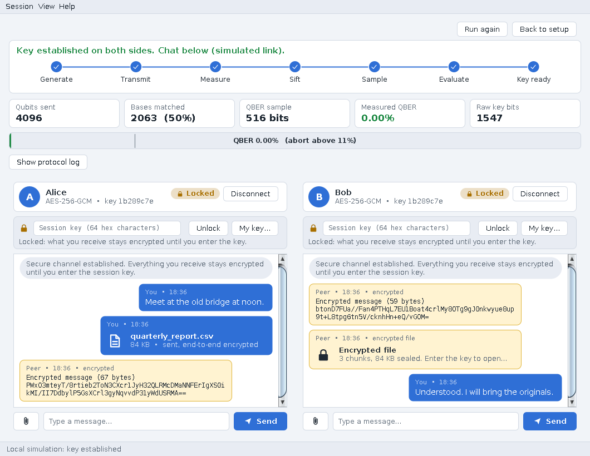
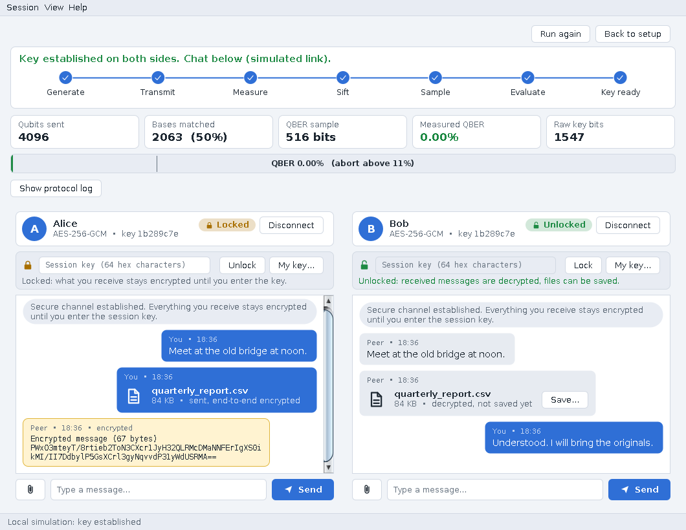
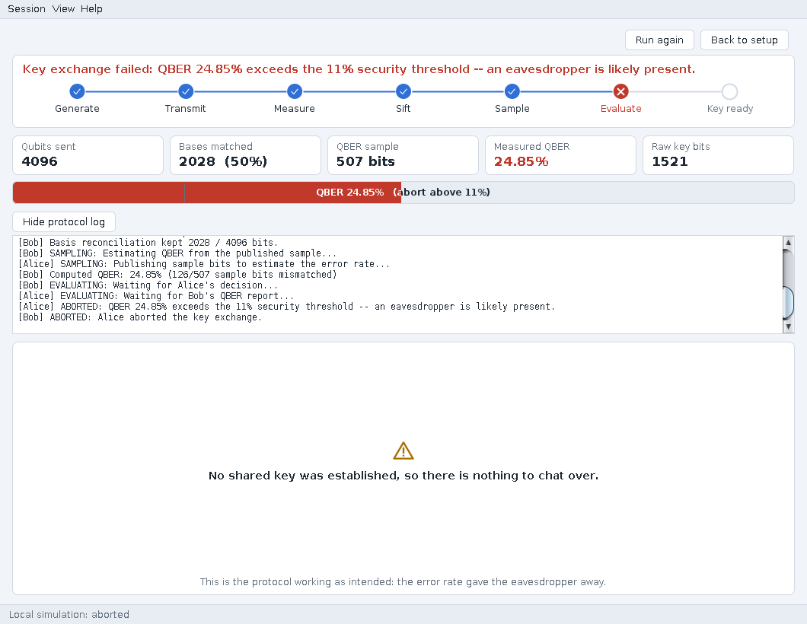
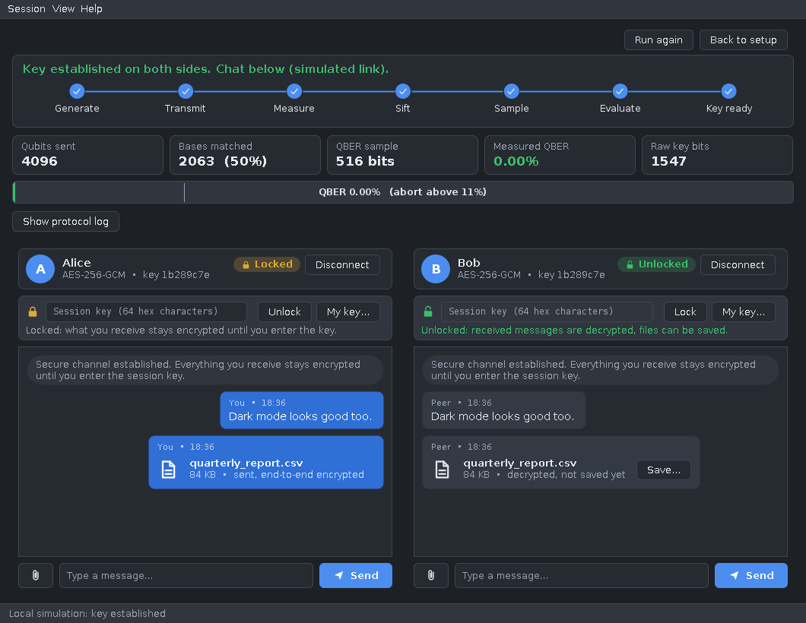
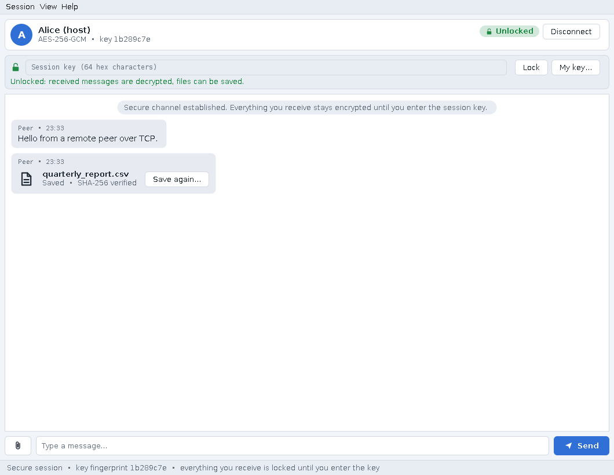

# Quantum-Secured Chat: BB84 simulation, encrypted messaging and file transfer

A Java desktop application (plain Swing, **no external libraries**) in which two
peers agree on a secret key with a **simulated BB84 quantum key exchange** and
then use it to protect everything they send with **AES-256-GCM**: chat messages
and files. Received data stays encrypted until the user enters the session key.



## Build and run (source only, no jar)

You need a **JDK 8 or newer** (a JDK, not just a JRE). Nothing else.

```bash
./build.sh                                   # Linux / macOS: compiles into ./out
java -cp out quantumchat.gui.QuantumChatGUI
```

Windows: run `build.bat`, then `java -cp out quantumchat.gui.QuantumChatGUI`.
By hand, from the project root:

```bash
mkdir out
javac -d out $(find quantumchat -name "*.java")
```
(on Windows cmd: `dir /s /b quantumchat\*.java > sources.txt` then `javac -d out @sources.txt`).

## What you can do

| | |
|---|---|
| **Host / Join** | One side hosts (Alice) on a port, the other joins (Bob) by address. They run BB84 over the socket, then chat. |
| **Local simulation** | Runs Alice *and* Bob in one window over an in-memory link: pick any scenario and see the result instantly, with two chat panes. |
| **Send text** | Type and press Enter. |
| **Send files** | Click the paperclip, or **drag files onto the conversation**. Files are encrypted, chunked, sent with a live progress bar, and verified on save. |
| **Key-gated reading** | Everything you *receive* is shown as ciphertext until you enter the session key. |
| **Scenarios** | Presets for an ideal channel, a noisy channel, weak/strong eavesdroppers; every parameter is editable, with a live "expected QBER" forecast. |
| **Dark / light** | View menu; switches live, even mid-conversation. |

### A tour

**Setup**: role cards, scenario presets, and a forecast of whether the exchange will succeed.
**Dashboard**: a step indicator, five live statistics, the QBER gauge and a collapsible protocol log.



**Locked by default.** Bob has received a text and a file; he can see only ciphertext (the file shows just "3 chunks, 84 KB sealed"). A wrong key (here, off by one character) is rejected and reveals nothing.




**With the right key** the text decrypts and the file can be saved; saving decrypts every chunk and checks the sender's SHA-256.




**An eavesdropper is caught**: the QBER jumps to ~25%, the step indicator marks "Evaluate" as failed, and no key (so no chat) exists.



Dark mode, and a real two-process session over TCP:




## How file transfer works

Every message on the wire is a `SecureFrame`:

```
byte   type         TEXT / FILE_META / FILE_CHUNK        } 13-byte header: readable,
int    transferId   groups the frames of one file        } but authenticated as
int    index        chunk number                         } AES-GCM "additional
int    total        number of chunks                     } authenticated data"
byte[] sealed       IV(12) || AES-256-GCM ciphertext || tag(16)
```

Sending a file: the sender hashes it, sends one sealed **header frame** (name, size,
chunk size, SHA-256), then the file in sealed **32 KB chunks**. The receiver collects
frames into an `IncomingFile` without needing the key, so a locked receiver can still show
progress. Only with the key can it read the name or write the file.

What this gives you (all covered by `test/FileTransferTest.java`):

- **Confidentiality**: file name, size, hash and contents are all inside the ciphertext.
- **Wrong key reveals nothing**: GCM authentication fails; nothing is written.
- **Tamper detection**: a flipped ciphertext bit is rejected.
- **No reordering / splicing / truncation**: the header (type, transfer id, index, total) is bound
  to each chunk's tag, so swapping chunks, pasting in a chunk from another transfer, or changing
  the chunk count all fail to decrypt.
- **End-to-end integrity**: the saved file's length and SHA-256 are checked against the sender's.
  On any failure the partial output is deleted.
- **Hardening**: oversized frames are refused (16 MB cap on a socket frame, 1.1 MB per message),
  chunk counts are bounded, received file names are sanitised before being offered in the save
  dialog, and text and files can be interleaved from different threads.

**Limits and honest caveats**

- Maximum file size is **64 MB**; received files are held in memory (still encrypted) until saved.
- The 13-byte header is *not* encrypted, so an observer on the wire can see that a transfer
  happened, roughly how big it is (chunk count) and the timing. Names, sizes and content are hidden.
- There is no resume or cancel for a transfer in progress.
- Dropping files works anywhere on the conversation *except* directly over a message's text.
- A TCP socket can't carry real qubits, so BB84 is **simulated** (see below). The confidentiality of
  your messages and files comes from AES-256-GCM, not from anything quantum.

## The BB84 side (unchanged core, configurable)

Alice and Bob exchange random bits in random bases; keeping only positions where the bases agree
(sifting) leaves ~50%. A sacrificed sample estimates the **QBER**; above the threshold (default
11%) the exchange aborts, which is how an intercept-resend eavesdropper (~25% QBER) is detected.
Leftover bit errors are then corrected by a Cascade-style block-parity **reconciliation** with a
hash verification (so keys either match exactly or the session aborts), and the key is hashed
(SHA-256) into a 256-bit AES key.

Configurable per run: qubit count, sample fraction, abort threshold, channel noise, eavesdropper
model (none / full / partial intercept-resend), and an optional seed for reproducible runs.
The protocol classes never touch a socket: they talk to a `QKDChannel` built on a pluggable
`MessageTransport` (real socket or in-memory), which is what makes Local simulation possible.

Caveat: parity exchange during reconciliation leaks a small amount of key information, which real
QKD accounts for formally in privacy amplification. Here it is simplified (educational, not
production-grade).

## Project layout

```
quantumchat/
  core/     BB84 framework: QKDConfig, AliceProtocol, BobProtocol, ErrorReconciliation,
            EavesdropperStrategy, NoiseModel, QKDChannel ...
  net/      MessageTransport (+ socket and in-memory), TransportQKDChannel
  crypto/   CryptoUtil: key derivation, AES-GCM (with AAD), hex/Base64 helpers
  chat/     SecureFrame, FileInfo, IncomingFile, ChatConnection (sendText / sendFile)
  gui/      QuantumChatGUI (window, menus, status bar), SetupPanel, ProtocolDashboard,
            QKDProgressPanel, LocalSimulationPanel, ChatPanel, Bubble, ChatView, FileCard,
            Theme (light/dark), Icons (vector icons), Widgets (themed controls)
test/       headless tests + GUI harnesses
screenshots/
```

## Tests

Headless (no display needed): `./build.sh test` runs

- `FrameworkSmokeTest`: clean exchange, eavesdropper abort, partial eavesdropper (succeeds, keys reconciled), noise, reproducibility
- `SocketSmokeTest`: key exchange and an encrypted message over a real TCP socket
- `KeyGateTest`: a key one bit off cannot decrypt; hex parsing
- `FileTransferTest`: 9 groups of checks: 9 file sizes around the chunk boundary (0 B to 3 MB),
  wrong key, tampering, reordering, splicing, truncation, size limits, interleaved text, hang-up
  detection, and 2 MB over TCP

GUI harnesses (need a display, e.g. `xvfb-run -a java -cp out GuiShowcase shots`): `GuiShowcase`
drives the real window in-process (local simulation, locked messages, wrong/right key, file
send and save with a byte-for-byte comparison, eavesdropper, dark mode, live theme switch) and
writes the screenshots; `NetworkedGuiTest` runs the GUI as host against a remote peer over a real
socket. The screenshots in this folder were produced by these harnesses.

Not automated: typing a path into the stock Swing file-chooser dialog (the dialog itself opens
correctly from the paperclip button, but synthetic keystrokes didn't reach it in my headless test
environment). The code behind it, `ChatPanel.sendFile`, is exercised by the harnesses.
